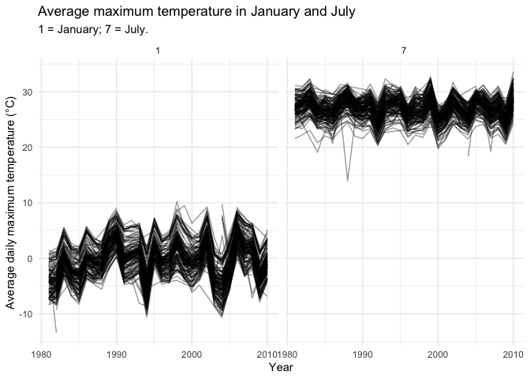
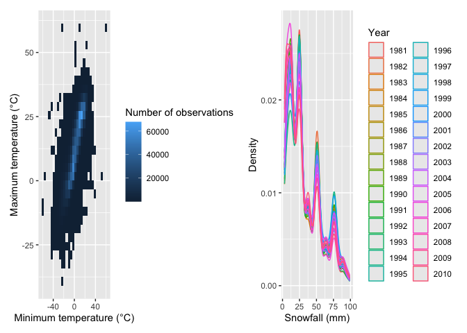
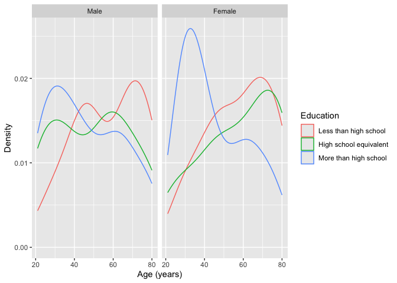
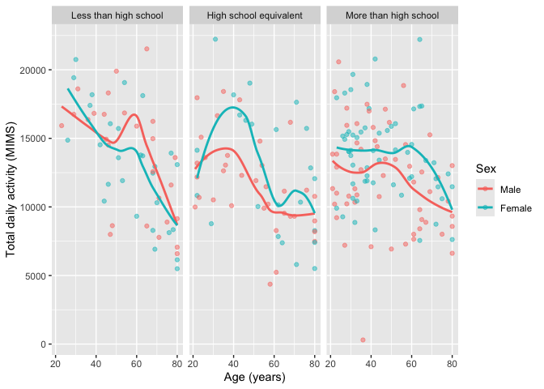
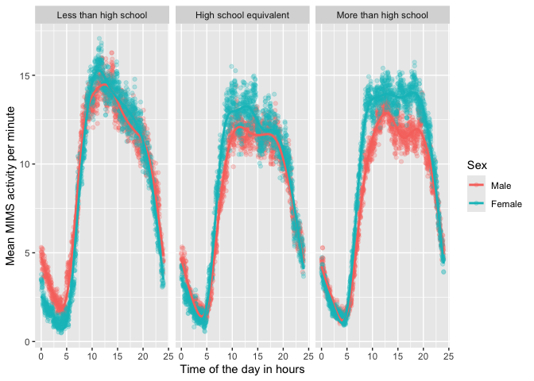
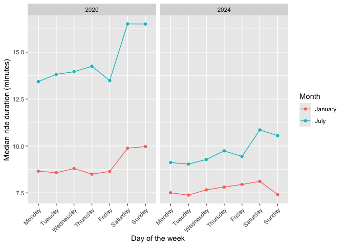
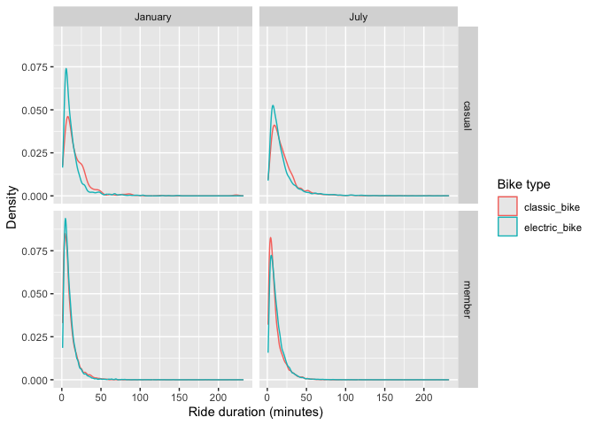

p8105_hw3_yp2743
================
Yueran Pan
2026-10-16

    ## ── Attaching core tidyverse packages ──────────────────────── tidyverse 2.0.0 ──
    ## ✔ dplyr     1.2.1     ✔ readr     2.2.0
    ## ✔ forcats   1.0.1     ✔ stringr   1.6.0
    ## ✔ ggplot2   4.0.3     ✔ tibble    3.3.1
    ## ✔ lubridate 1.9.5     ✔ tidyr     1.3.2
    ## ✔ purrr     1.2.2     
    ## ── Conflicts ────────────────────────────────────────── tidyverse_conflicts() ──
    ## ✖ dplyr::filter() masks stats::filter()
    ## ✖ dplyr::lag()    masks stats::lag()
    ## ℹ Use the conflicted package (<http://conflicted.r-lib.org/>) to force all conflicts to become errors

## Problem 1: exploration of NY NOAA dataset

``` r
library(p8105.datasets)
data("ny_noaa")
str(ny_noaa)
```

    ## tibble [2,595,176 × 7] (S3: tbl_df/tbl/data.frame)
    ##  $ id  : chr [1:2595176] "US1NYAB0001" "US1NYAB0001" "US1NYAB0001" "US1NYAB0001" ...
    ##  $ date: Date[1:2595176], format: "2007-11-01" "2007-11-02" ...
    ##  $ prcp: int [1:2595176] NA NA NA NA NA NA NA NA NA NA ...
    ##  $ snow: int [1:2595176] NA NA NA NA NA NA NA NA NA NA ...
    ##  $ snwd: int [1:2595176] NA NA NA NA NA NA NA NA NA NA ...
    ##  $ tmax: chr [1:2595176] NA NA NA NA ...
    ##  $ tmin: chr [1:2595176] NA NA NA NA ...
    ##  - attr(*, "spec")=
    ##   .. cols(
    ##   ..   id = col_character(),
    ##   ..   date = col_date(format = ""),
    ##   ..   prcp = col_integer(),
    ##   ..   snow = col_integer(),
    ##   ..   snwd = col_integer(),
    ##   ..   tmax = col_character(),
    ##   ..   tmin = col_character()
    ##   .. )

``` r
#check missing var % for precipitation, snow, snow depth, maximum temperature, minimum temperature. I want to write a simple form to check all missing percentage across column instead of running 7 chunks of `mean(is.na(x))`.

ny_noaa |>
  summarise(
    across(everything(), ~ mean(is.na(.x)) * 100)
  )
```

    ## # A tibble: 1 × 7
    ##      id  date  prcp  snow  snwd  tmax  tmin
    ##   <dbl> <dbl> <dbl> <dbl> <dbl> <dbl> <dbl>
    ## 1     0     0  5.62  14.7  22.8  43.7  43.7

This dataset contains 2,595,176 observations and 7 key variables: `id`,
`date`, precipitation (tenth of mm), snowfall (mm), snow depth (mm),
maximum temperature (tenth of Celsius degree), and minimum temperature
(tenth of Celsius degree). Each row represents a daily weather
observation at a particular station, identifeid by `id`. No `id` or
`date` is missing. However, approximately 43.71% of observations are
missing maximum or minimum temperature values, which might limit the
data available for temperature analyses below. Precipitation data has
5.62% of missing data, snow has 14.69% of missing data, and snow depth
has 22.80% of missing data.

``` r
noaa_df = ny_noaa |>
janitor::clean_names() |>
separate(date, into = c("year", "month","date"), sep = "-") |>
  mutate(year = as.numeric(year), 
         month = as.numeric(month), 
         date =  as.numeric(date),
         tmax_c = as.numeric(tmax)/10,
         tmin_c = as.numeric(tmin)/10,
         prcp_mm = prcp /10
  )
noaa_df |> 
    count(snow, sort = TRUE)
```

    ## # A tibble: 282 × 2
    ##     snow       n
    ##    <int>   <int>
    ##  1     0 2008508
    ##  2    NA  381221
    ##  3    25   31022
    ##  4    13   23095
    ##  5    51   18274
    ##  6    76   10173
    ##  7     8    9962
    ##  8     5    9748
    ##  9    38    9197
    ## 10     3    8790
    ## # ℹ 272 more rows

Convert observations for temperature, precipitation, and snowfall to
reasonable units: Tmax and Tmin from 10th Celsius to Celsius,
precipitation from tenth mm to mm. Snowfall is already recorded in
milimeters and does not require conversion.

For snowfall, the most commonly observed value is 0mm. This is expected
because the dataset includes observations throughout the year.

#### Q1.2Make a two-panel plot showing the average max temperature in January and in July in each station across years.

``` r
tmax_df = noaa_df |>
  filter(month %in% c(1, 7)) |>
  group_by(id, year, month) |>
  summarise(
    tmax_avg_month = mean(tmax_c, na.rm = TRUE)
  )|>
      ungroup()
```

    ## `summarise()` has regrouped the output.
    ## ℹ Summaries were computed grouped by id, year, and month.
    ## ℹ Output is grouped by id and year.
    ## ℹ Use `summarise(.groups = "drop_last")` to silence this message.
    ## ℹ Use `summarise(.by = c(id, year, month))` for per-operation grouping
    ##   (`?dplyr::dplyr_by`) instead.

``` r
#Making plot
tmax_df |>
  ggplot(aes(x = year, y = tmax_avg_month, group = id)) +
  geom_line(alpha = 0.4) + 
  facet_grid(. ~ month) +
  labs(
    title = "Average maximum temperature in January and July",
    subtitle = "1 = January; 7 = July.",
    x = "Year",
    y = "Average daily maximum temperature (°C)"
  ) +
  theme_minimal()
```

    ## Warning: Removed 5932 rows containing missing values or values outside the scale range
    ## (`geom_line()`).

<!-- -->

#### Q1.2.2: Is there any observable / interpretable structure? Any outliers?

Based on the plot, every year, July’s average maximum temperature is
much higher (around 20°C higher, estimated roughly by eyes) than
January’s average maximum temperature. Stations show similar
year-to-year fluctuations, but January’s variability is greater than
July’s. Around year 1987/1988, one station’s average maximum temperature
in July is approximately 14°C, which might be a potential outlier.
There’s also a low temperature an around -13.5°C in year 1982 in
January’s plot.

#### Q1.3 Make a two-panel plot showing (i) tmax vs tmin for the full dataset (note that a scatterplot may not be the best option);

``` r
temp_plot = noaa_df |>
  ggplot(aes(x = tmin_c, y = tmax_c)) +
  geom_bin2d() +
  labs(
    x = "Minimum temperature (°C)",
    y = "Maximum temperature (°C)",
    fill = "Number of observations"
  )
```

### Q1.3(ii, continue) make a plot showing the distribution of snowfall values greater than 0 and less than 100 separately by year.

``` r
#Making plot
snow_plot = noaa_df |>
  filter(snow > 0, snow < 100) |>
  ggplot(aes(x = snow, color = factor(year))) +
  geom_density() +
  labs(
    x = "Snowfall (mm)",
    y = "Density",
    color = "Year"
  )


#merge templot and snowplot
library(patchwork)

temp_plot + snow_plot
```

    ## `stat_bin2d()` using `bins = 30`. Pick better value `binwidth`.

    ## Warning: Removed 1136276 rows containing non-finite outside the scale range
    ## (`stat_bin2d()`).

<!-- -->

## Problem 2

Accelerometers have become an appealing alternative to self-report
techniques for studying physical activity in observational studies and
clinical trials, largely because of their relative objectivity. During
observation periods, the devices can measure MIMS in a short period;
one-minute intervals are common. Because accelerometers can be worn
comfortably and unobtrusively, they produce around-the-clock
observations.

This problem uses accelerometer data collected on 250 participants in
the NHANES study. The participants’ demographic data can be downloaded
here, and their accelerometer data can be downloaded here. Variables
\*MIMS are the MIMS values for each minute of a 24-hour day starting at
midnight.

``` r
covar_raw_df = read_csv(
  "./nhanes_covar.csv",
  skip = 4
) |>
  janitor::clean_names()
```

    ## Rows: 250 Columns: 5
    ## ── Column specification ────────────────────────────────────────────────────────
    ## Delimiter: ","
    ## dbl (5): SEQN, sex, age, BMI, education
    ## 
    ## ℹ Use `spec()` to retrieve the full column specification for this data.
    ## ℹ Specify the column types or set `show_col_types = FALSE` to quiet this message.

``` r
accel_raw_df = read_csv(
  "./nhanes_accel.csv"
) |>
  janitor::clean_names()
```

    ## Rows: 250 Columns: 1441
    ## ── Column specification ────────────────────────────────────────────────────────
    ## Delimiter: ","
    ## dbl (1441): SEQN, min1, min2, min3, min4, min5, min6, min7, min8, min9, min1...
    ## 
    ## ℹ Use `spec()` to retrieve the full column specification for this data.
    ## ℹ Specify the column types or set `show_col_types = FALSE` to quiet this message.

``` r
head(covar_raw_df)
```

    ## # A tibble: 6 × 5
    ##    seqn   sex   age   bmi education
    ##   <dbl> <dbl> <dbl> <dbl>     <dbl>
    ## 1 62161     1    22  23.3         2
    ## 2 62164     2    44  23.2         3
    ## 3 62169     1    21  20.1         2
    ## 4 62174     1    80  33.9         3
    ## 5 62177     1    51  20.1         2
    ## 6 62178     1    80  28.5         2

``` r
accel_raw_df |>
  select(seqn, min1:min5) |>
  head()
```

    ## # A tibble: 6 × 6
    ##    seqn  min1  min2  min3  min4   min5
    ##   <dbl> <dbl> <dbl> <dbl> <dbl>  <dbl>
    ## 1 62161 1.11  3.12  1.47  0.938 1.60  
    ## 2 62164 1.92  1.67  2.38  0.935 2.59  
    ## 3 62169 5.85  5.18  4.76  6.48  6.85  
    ## 4 62174 5.42  3.48  3.72  3.81  6.85  
    ## 5 62177 6.14  8.06  9.99  6.60  4.57  
    ## 6 62178 0.167 0.429 0.131 1.20  0.0796

``` r
#tidy up
covar_df = covar_raw_df |>
  filter(age >=21) |>
  drop_na(sex, age, bmi, education) |>
mutate(
  sex = case_match(
    sex,
    1 ~ "Male",
    2 ~ "Female"
  ),
  sex = as.factor(sex),
  sex = fct_relevel(sex, "Male", "Female"),

  education = case_match(
    education,
    1 ~ "Less than high school",
    2 ~ "High school equivalent",
    3 ~ "More than high school"
  ),
  education = as.factor(education),
  education = fct_relevel(
    education,
    "Less than high school",
    "High school equivalent",
    "More than high school"
  )
)
```

    ## Warning: There was 1 warning in `mutate()`.
    ## ℹ In argument: `sex = case_match(sex, 1 ~ "Male", 2 ~ "Female")`.
    ## Caused by warning:
    ## ! `case_match()` was deprecated in dplyr 1.2.0.
    ## ℹ Please use `recode_values()` instead.

``` r
accel_df = accel_raw_df |>
  pivot_longer(
    cols = min1:min1440,
    names_to = "minute",
    values_to = "mims",
    names_prefix = "min"
  ) |>
  mutate(minute = as.numeric(minute))

#merge
q2_df = covar_df |>
  left_join(accel_df, by = "seqn")
```

### Q2. 2 Produce a reader-friendly table for the number of men and women in each education category, and create a visualization of the age distributions for men and women in each education category.

``` r
covar_df |>
  count(education, sex) |>
  pivot_wider(
    names_from = sex,
    values_from = n
  ) |>
  knitr::kable(
    col.names = c("Education", "Men(n)", "Women(n)")
  )
```

| Education              | Men(n) | Women(n) |
|:-----------------------|-------:|---------:|
| Less than high school  |     27 |       28 |
| High school equivalent |     35 |       23 |
| More than high school  |     56 |       59 |

``` r
covar_df |>
  ggplot(aes(x = age, color = education)) +
  geom_density() +
  facet_grid(. ~ sex) +
  labs(
    x = "Age (years)",
    y = "Density",
    color = "Education"
  )
```

<!-- -->

228 participants remained after restricting the sample to participants
aged 21+ years and excluding those with missing demographic data. There
were 27 men and 28 women with less than a high school education, 35 men
and 23 women with a high school equivalent education, and 56 men and 59
women with more than a high school education.

Among women, the age distribution for those with more than a high school
education peaks around age 25, while the other two education groups have
higher densities at older ages, forming two opposite age trends. Among
men, the less-than-high-school group peaks around age 70, and has the
lowest proportion among age ~ 21-30. In this sample, higher educational
level seems to associate with younger age, especially among women.

``` r
total_activity_df = q2_df |>
  group_by(seqn, sex, age, education) |>
  summarise(
    total_activity = sum(mims)
  ) |>
  ungroup()
```

    ## `summarise()` has regrouped the output.
    ## ℹ Summaries were computed grouped by seqn, sex, age, and education.
    ## ℹ Output is grouped by seqn, sex, and age.
    ## ℹ Use `summarise(.groups = "drop_last")` to silence this message.
    ## ℹ Use `summarise(.by = c(seqn, sex, age, education))` for per-operation
    ##   grouping (`?dplyr::dplyr_by`) instead.

``` r
total_activity_df |>
  ggplot(aes(x = age, y = total_activity, color = sex)) +
  geom_point(alpha = 0.5) +
  geom_smooth(se = FALSE) +
  facet_grid(. ~ education) +
  labs(
    x = "Age (years)",
    y = "Total daily activity (MIMS)",
    color = "Sex"
  )
```

    ## `geom_smooth()` using method = 'loess' and formula = 'y ~ x'

<!-- -->

Among those with less than high school degree, since age of 40, males
have higher total daily activity comparing to females. Among those with
high school or more than high school degree, females tend to have higher
daily activity comparing to males. Comparing across these three
categories, people with less than high school degree seem to have
highest total daily activity around age 21-40. All educational groups’
people, regardless of their gender, total daily activity tends to be
lower at older ages.

### Q2.3 three-panel plot that shows the 24-hour activity time courses for each education level and use color to indicate sex

``` r
daily_activity_df = q2_df |>
  group_by(sex, education, minute) |>
  summarise(
    mean_mims = mean(mims)
  ) |>
  ungroup()|>
  mutate (hour = (minute-1) /60)
```

    ## `summarise()` has regrouped the output.
    ## ℹ Summaries were computed grouped by sex, education, and minute.
    ## ℹ Output is grouped by sex and education.
    ## ℹ Use `summarise(.groups = "drop_last")` to silence this message.
    ## ℹ Use `summarise(.by = c(sex, education, minute))` for per-operation grouping
    ##   (`?dplyr::dplyr_by`) instead.

``` r
daily_activity_df |>
  ggplot(aes(x = hour, y = mean_mims, color = sex)) +
  geom_point(alpha = 0.25) +
  geom_smooth(se = FALSE) +
  facet_grid(. ~ education) +
  labs(
    x = "Time of the day in hours",
    y = "Mean MIMS activity per minute",
    color = "Sex"
  )
```

    ## `geom_smooth()` using method = 'gam' and formula = 'y ~ s(x, bs = "cs")'

<!-- -->
Comparing across groups, no significant time-daily activity has been
found. Three groups all seem to have lowest MIMS activity around 0-7am,
then peak 7-10am, stays flat or decreases until 8pm, then decreases 8pm
to 12am. However, for both sex, it seems like people with less than high
school educational attainment tends to have slightly higher MIMS
activity per minute, comparing to the other two groups.

## Problem 3

Citi Bike is a bike sharing system in New York City; riders can rent
pedal-powered or electric bikes from starting stations and return them
to another station at their destination. Introduced in 2013, the system
is immensely popular and expanded rapidly. Riders who use this system
often may become “members” with lower rental rates.

This zip file contains data on rides taken on the NYC Citi Bike system.
Files contain 1% of all rides with a total duration less than 4 hours in
each of four months. \#### Q3.1 Import, clean, and tidy these data, and
describe the resulting dataset.

``` r
jan_2020_df = read_csv("./citibike/Jan 2020 Citi.csv") |>
  janitor::clean_names() |>
  mutate(year = 2020, month = "January")
```

    ## Rows: 12420 Columns: 7
    ## ── Column specification ────────────────────────────────────────────────────────
    ## Delimiter: ","
    ## chr (6): ride_id, rideable_type, weekdays, start_station_name, end_station_n...
    ## dbl (1): duration
    ## 
    ## ℹ Use `spec()` to retrieve the full column specification for this data.
    ## ℹ Specify the column types or set `show_col_types = FALSE` to quiet this message.

``` r
july_2020_df = read_csv("./citibike/July 2020 Citi.csv") |>
  janitor::clean_names() |>
  mutate(year = 2020, month = "July")
```

    ## Rows: 21048 Columns: 7
    ## ── Column specification ────────────────────────────────────────────────────────
    ## Delimiter: ","
    ## chr (6): ride_id, rideable_type, weekdays, start_station_name, end_station_n...
    ## dbl (1): duration
    ## 
    ## ℹ Use `spec()` to retrieve the full column specification for this data.
    ## ℹ Specify the column types or set `show_col_types = FALSE` to quiet this message.

``` r
jan_2024_df = read_csv("./citibike/Jan 2024 Citi.csv") |>
  janitor::clean_names() |>
  mutate(year = 2024, month = "January")
```

    ## Rows: 18861 Columns: 7
    ## ── Column specification ────────────────────────────────────────────────────────
    ## Delimiter: ","
    ## chr (6): ride_id, rideable_type, weekdays, start_station_name, end_station_n...
    ## dbl (1): duration
    ## 
    ## ℹ Use `spec()` to retrieve the full column specification for this data.
    ## ℹ Specify the column types or set `show_col_types = FALSE` to quiet this message.

``` r
july_2024_df = read_csv("./citibike/July 2024 Citi.csv") |>
  janitor::clean_names() |>
  mutate(year = 2024, month = "July")
```

    ## Rows: 47156 Columns: 7
    ## ── Column specification ────────────────────────────────────────────────────────
    ## Delimiter: ","
    ## chr (6): ride_id, rideable_type, weekdays, start_station_name, end_station_n...
    ## dbl (1): duration
    ## 
    ## ℹ Use `spec()` to retrieve the full column specification for this data.
    ## ℹ Specify the column types or set `show_col_types = FALSE` to quiet this message.

``` r
citibike_df = bind_rows(
  jan_2020_df,
  july_2020_df,
  jan_2024_df,
  july_2024_df
) |>
  mutate(
    month = factor(month, levels = c("January", "July")),
    weekdays = factor(
      weekdays,
      levels = c(
        "Monday", "Tuesday", "Wednesday", "Thursday",
        "Friday", "Saturday", "Sunday"
      )
    ),
    member_casual = factor(
      member_casual,
      levels = c("casual", "member")
    ),
    rideable_type = as.factor(rideable_type)
  )

citibike_df
```

    ## # A tibble: 99,485 × 9
    ##    ride_id   rideable_type weekdays duration start_station_name end_station_name
    ##    <chr>     <fct>         <fct>       <dbl> <chr>              <chr>           
    ##  1 4BE06CB3… classic_bike  Tuesday     15.3  Columbus Ave & W … E 53 St & Madis…
    ##  2 26886E03… classic_bike  Wednesd…     5.31 2 Ave & E 96 St    1 Ave & E 110 St
    ##  3 24DC5606… classic_bike  Friday       9.69 Columbia St & Riv… Grand St & Eliz…
    ##  4 EEDC1053… classic_bike  Sunday       7.00 W 84 St & Columbu… Columbus Ave & …
    ##  5 2CD4BD4C… classic_bike  Friday       2.85 Forsyth St & Broo… Suffolk St & St…
    ##  6 E18682F9… classic_bike  Sunday      25.5  Allen St & Hester… Atlantic Ave & …
    ##  7 B9B2E896… classic_bike  Sunday       3.65 Lafayette St & Je… Washington Pl &…
    ##  8 DEF8F504… classic_bike  Sunday      38.3  28 Ave & 44 St     Broadway & Kosc…
    ##  9 17D44DA9… classic_bike  Thursday    38.5  Barrow St & Hudso… Emerson Pl & My…
    ## 10 0FD113A3… classic_bike  Tuesday      6.52 Carlton Ave & Par… Emerson Pl & My…
    ## # ℹ 99,475 more rows
    ## # ℹ 3 more variables: member_casual <fct>, year <dbl>, month <fct>

``` r
citibike_df |>
  summarise(
    across(everything(), ~ mean(is.na(.x)) * 100))
```

    ## # A tibble: 1 × 9
    ##   ride_id rideable_type weekdays duration start_station_name end_station_name
    ##     <dbl>         <dbl>    <dbl>    <dbl>              <dbl>            <dbl>
    ## 1       0             0        0        0             0.0432            0.208
    ## # ℹ 3 more variables: member_casual <dbl>, year <dbl>, month <dbl>

``` r
citibike_df |>
  summarise(
    missing_start = sum(is.na(start_station_name)),
    missing_end = sum(is.na(end_station_name)))
```

    ## # A tibble: 1 × 2
    ##   missing_start missing_end
    ##           <int>       <int>
    ## 1            43         207

Describe the resulting dataset: This dataset is merged from four
different month’s NYC Citi biker who ride less than 4 hr each month.
Overall, it 99,485 observations (row) and 9 key variables: `ride_id`,
`rideable_type`, `weekdays`, `duration`, `start station name`,
`end station name`, `member casual`, `year`, and `month`. `year`, and
`month` are added manually to distinguish periods. Except start station
(missing 43 records) and end station (missing 207 records), no other
variable has missing data.

#### Q3.2: Produce a reader-friendly table showing the total number of rides in each combination of year and month separating casual riders and Citi Bike members. Comment on these results.

``` r
citibike_df |>
  count(year, month, member_casual) |>
  pivot_wider(
    names_from = member_casual,
    values_from = n,
    values_fill = 0
  ) |>
  knitr::kable(
    col.names = c(
      "Year", "Month", "Casual rides (n)", "Member rides (n)"
    )
  )
```

| Year | Month   | Casual rides (n) | Member rides (n) |
|-----:|:--------|-----------------:|-----------------:|
| 2020 | January |              984 |            11436 |
| 2020 | July    |             5637 |            15411 |
| 2024 | January |             2108 |            16753 |
| 2024 | July    |            10894 |            36262 |

Among rides less than 4 hours each time: In 2020, January, there were
984 casual rides and 11435 member rides. In 2020, July, there were 5637
casual rides and 15411 member rides. In 2024, January, there were 2108
casual rides and 16753 member rides. In 2024, July, there were 10894
casual rides and 36262 member rides.

#### Q3.3 Make a table showing the 5 most popular starting stations for July 2024; include the number of rides originating from these stations.

``` r
citibike_df |>
  filter(year == 2024, month == "July") |>
  drop_na(start_station_name) |>
  count(start_station_name) |>
  arrange(desc(n)) |>
  head(5) |>
  knitr::kable(
    col.names = c("Starting station", "Number of rides")
  )
```

| Starting station         | Number of rides |
|:-------------------------|----------------:|
| Pier 61 at Chelsea Piers |             163 |
| University Pl & E 14 St  |             155 |
| W 21 St & 6 Ave          |             152 |
| West St & Chambers St    |             150 |
| W 31 St & 7 Ave          |             146 |

Top 5 starting stations in July, 2024: Pier 61 at Chelsea Piers (163
rides), University Pl & E 14 St (155 rides), W 21 St & 6 Ave 1(52
rides), West St & Chambers St (150 rides), W 31 St & 7 Ave (146 rides).

#### Q3.4 Make a plot to investigate the effects of day of the week, month, and year on median ride duration. This plot can include one or more panels, but should facilitate comparison across all variables of interest.

``` r
median_duration_df = citibike_df |>
  group_by(year, month, weekdays) |>
  summarise(
    median_duration = median(duration)
  ) |>
  ungroup()
```

    ## `summarise()` has regrouped the output.
    ## ℹ Summaries were computed grouped by year, month, and weekdays.
    ## ℹ Output is grouped by year and month.
    ## ℹ Use `summarise(.groups = "drop_last")` to silence this message.
    ## ℹ Use `summarise(.by = c(year, month, weekdays))` for per-operation grouping
    ##   (`?dplyr::dplyr_by`) instead.

``` r
median_duration_df |>
  ggplot(
    aes(
      x = weekdays,
      y = median_duration,
      color = month,
      group = month
    )
  ) +
  geom_point() +
  geom_line() +
  facet_grid(. ~ year) +
  labs(
    x = "Day of the week",
    y = "Median ride duration (minutes)",
    color = "Month"
  ) +
  theme(
    axis.text.x = element_text(angle = 45, hjust = 1)
  )
```

<!-- -->

Median ride duration (min) is consistently highest in July 2020 across
all days of the week. For both January and July, median ride durations
are higher in 2020 than in 2024. Weekend rides generally have longer
median durations, especially in July 2020. In January 2024, median
duration peaks on Saturday and then decreases on Sunday.

#### Q3.5 For data in 2024, make a figure that shows the impact of month, membership status, and bike type on the distribution of ride duration. Comment on your results.

``` r
citibike_df |>
  filter(year == 2024) |>
  ggplot(aes(x = duration, color = rideable_type)) +
  geom_density() +
  facet_grid(member_casual ~ month) +
  labs(
    x = "Ride duration (minutes)",
    y = "Density",
    color = "Bike type"
  )
```

<!-- -->

In 2024, all distributions are right-skewed, with relatively few long
rides. Comparing to casual rider, members’ ride durations are more
concentrated at shorter durations. Among casual riders, electric-bike
rides have a more prominent peak at short durations (0min-25mins), while
classic-bike rides have a broader distribution. Among members, the
distributions for the two bike types are similar, although the
classic-bike rides peak in July is slightly higher. July generally shows
broader distributions with lower peaks. Perhaps during summertime,
people feel more comfortable to engage in outdoor activity (compairng to
winter it might be cold to ride outside).
